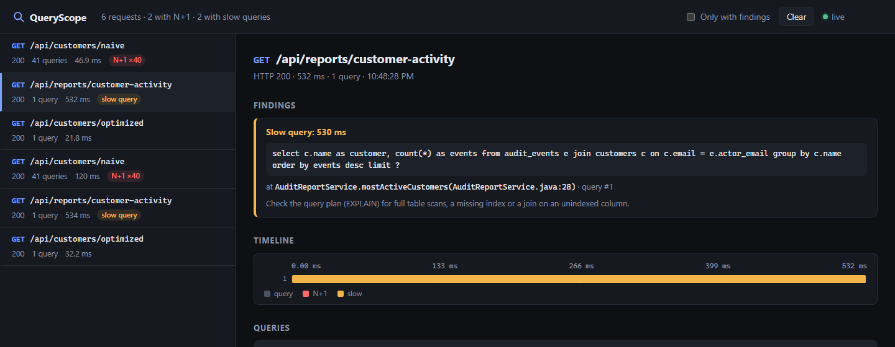

<h1 align="center">QueryScope</h1>

<p align="center">
  <b>Find N+1 and slow SQL queries in a Spring Boot app without touching its code.</b><br>
  A Java agent that watches every JDBC call, groups the queries of each HTTP request and shows them on a live timeline.
</p>

<p align="center">
  <a href="https://github.com/zitreF/queryscope/actions/workflows/build.yml"></a>
  
  
  
  
</p>


```bash
java -jar queryscope.jar your-app.jar
```

That is the whole setup: QueryScope starts your app with the agent attached. Open http://localhost:7070 and use the
app, and stop both with Ctrl+C.

## Features

- **No code changes.** Attach the agent with `-javaagent`. Nothing goes into your `pom.xml` or `build.gradle`.
- **N+1 detection.** The same SELECT repeated within one request is reported together with the line of your code
  that triggered it, for example `CustomerSummary.of(CustomerSummary.java:12)`.
- **Slow queries.** Every query above a threshold you choose, 100 ms by default.
- **Live tracking.** Keep the app running and use it: the Live tab draws every request on a moving time axis, with
  one tick per SQL query, N+1 requests in red and slow ones in yellow. Below are live counters, a table of endpoints
  by time spent in the database and the latest findings. A short notice appears whenever a new problem shows up.
- **Request details.** The Requests tab shows each request's findings, its queries on a timeline and the full SQL with
  syntax highlighting.
- **Any data access code.** Works under Hibernate, Spring Data JPA, `JdbcClient`, `JdbcTemplate` or plain JDBC, with
  any driver and connection pool.
- **Not only HTTP.** Queries that run outside a request, in scheduled jobs, message listeners or a plain `main`, are
  grouped into tasks, one per connection or transaction, and any method can become its own task with `entry=`.
- **Stays out of the way.** ByteBuddy is shaded, the panel listens on localhost only, its threads are daemons, and an
  exception inside the instrumentation is swallowed instead of breaking a request.

## Quick start

The tests contain a small demo shop with a deliberate N+1, its fixed version and a slow report. `runDemo` builds the
agent and starts the shop with it attached:

```bash
git clone https://github.com/zitreF/queryscope.git
cd queryscope
./gradlew runDemo
```

On Windows use `gradlew.bat`. Open the panel at http://localhost:7070 and call the endpoints:

| Endpoint                                            | What it does                                                        | QueryScope shows        |
|-----------------------------------------------------|---------------------------------------------------------------------|-------------------------|
| http://localhost:8080/api/customers/naive           | `findAll()`, then reads each customer's lazy `orders` collection    | 41 queries, N+1 ×40     |
| http://localhost:8080/api/customers/optimized       | the same summaries with `left join fetch c.orders`                  | 1 query, no findings    |
| http://localhost:8080/api/reports/customer-activity | joins 150k audit events with customers on an unindexed email column | slow query, about 0.5 s |

The demo also runs a scheduled job every 30 seconds that builds the same naive summaries outside any HTTP request. It
shows up as the task `CustomerService.summariesNaive` with the same N+1, and the data loaded at startup shows up as
`DemoApplication.main` with its 150k-row insert flagged as slow.

## Example: finding and fixing an N+1

A customer in the demo has a lazy list of orders:

```java
@Entity
@Table(name = "customers")
public class Customer {

    @Id
    private Long id;

    private String name;

    @OneToMany(mappedBy = "customer")
    private List<CustomerOrder> orders = new ArrayList<>();
}
```

The service builds a summary of every customer, with the number of orders and the money spent:

```java
public List<CustomerSummary> summariesNaive() {
    return customers.findAll(Sort.by("id")).stream()
            .map(CustomerSummary::of)
            .toList();
}
```

The code looks innocent. `findAll` loads the 40 customers in one query, but `CustomerSummary.of` reads
`customer.getOrders()`, and because the collection is lazy, Hibernate goes back to the database once for every
customer.

**1. Run the app with the agent and call the endpoint.**

```bash
./gradlew runDemo
curl http://localhost:8080/api/customers/naive
```

**2. See what QueryScope found.** The request appears in the Live tab as a red bar, and the Requests tab shows
it with an `N+1 ×40` badge, the 40 repeated queries red on its timeline, and the line that runs them:


The same goes to the app's own log:

```
INFO  QueryScope : GET /api/customers/naive -> 200, 41 queries in 46.9 ms
WARN  QueryScope : N+1: 40 x select o1_0.customer_id,o1_0.id,o1_0.placed_at,o1_0.total from orders o1_0 where o1_0.customer_id=? at me.fertiz.queryscope.demo.customer.CustomerSummary.of(CustomerSummary.java:12)
```

**3. Fix it** by loading the orders together with the customers:

```java
@Query("select c from Customer c left join fetch c.orders order by c.id")
List<Customer> findAllWithOrders();
```

**4. Check again.** The fixed endpoint returns exactly the same summaries with one query and no warning:

```
INFO  QueryScope : GET /api/customers/optimized -> 200, 1 query in 21.8 ms
```

Slow queries are reported the same way. The demo report joins two tables on a column without an index, so the
database compares every audit event with every customer:

```
INFO  QueryScope : GET /api/reports/customer-activity -> 200, 1 query in 532.1 ms
WARN  QueryScope : Slow query: 530.5 ms select c.name as customer, count(*) as events from audit_events e join customers c on c.email = e.actor_email group by c.name order by events desc limit ? at me.fertiz.queryscope.demo.report.AuditReportService.mostActiveCustomers(AuditReportService.java:28)
```



## Attaching it to your own app

Build the agent once with `./gradlew shadowJar`, which writes `build/libs/queryscope.jar`.

**Let QueryScope start it**

```bash
java -jar queryscope.jar your-app.jar
java -jar queryscope.jar --port=9090 --slowQueryMs=250 your-app.jar --server.port=8081
java -Xmx1g -Dspring.profiles.active=local -jar queryscope.jar -cp "lib/*" com.acme.Main
```

Options before the jar go to QueryScope, arguments after it go to the app, and JVM options of the `java` command
are passed on to the app. Ctrl+C stops both, and if the launcher is killed the app shuts itself down instead of
holding on to its port. `java -jar queryscope.jar --help` lists the options.

**Attach it yourself**: pass the jar to the JVM that runs your app.

```bash
java -javaagent:/path/to/queryscope.jar -jar your-app.jar
```

**Gradle `bootRun`** (`build.gradle.kts`)

```kotlin
tasks.bootRun {
    jvmArgs("-javaagent:/path/to/queryscope.jar")
}
```

**Maven**

```bash
./mvnw spring-boot:run -Dspring-boot.run.jvmArguments="-javaagent:/path/to/queryscope.jar"
```

**IntelliJ IDEA**: *Run → Edit Configurations → Modify options → Add VM options*, then enter
`-javaagent:/path/to/queryscope.jar`.

### Options

With `-javaagent` the options go after the jar path, separated by commas. The launcher takes the same options as
`--name=value` arguments:

```bash
java -javaagent:/path/to/queryscope.jar=port=9090,nPlusOneThreshold=3,slowQueryMs=250,entry=com.acme.ImportJob#run -jar your-app.jar
```

| Option              | Default | Meaning                                                      |
|---------------------|---------|--------------------------------------------------------------|
| `port`              | `7070`  | Port of the panel on localhost                               |
| `nPlusOneThreshold` | `5`     | How many runs of the same SELECT in one request make an N+1  |
| `slowQueryMs`       | `100`   | Queries taking at least this long are reported as slow       |
| `entry`             | none    | `Class#method` whose call becomes one task, can be repeated  |

An unknown option or a value that is not a positive number stops the JVM at startup with a message that names it. If
the port is taken, the panel is skipped and findings still go to the log.

QueryScope needs Java 17 or newer and works with any Java app that talks to its database through JDBC:

- **HTTP requests** are recognized in any servlet container, on `jakarta.servlet` and `javax.servlet` alike, so
  Spring Boot 2, 3 and 4, Tomcat, Jetty and Undertow all work.
- **Everything else** becomes a task: a scheduled job, a message listener, a batch run or a CLI. A task starts with
  the first query outside a request and ends when the connection is closed or the transaction committed, and it is
  named after the application method that ran the queries, such as `ImportJob.run`. With `entry=` a whole method
  call is one task, however many connections it uses.

The demo and the end-to-end test run Spring Boot 4.1 on Tomcat with HikariCP and H2, and `javax.servlet` and tasks are
covered by in-process tests. QueryScope is a development tool that keeps the SQL of the last 200 requests and tasks
in memory, so don't attach it in production.

## Using the results in scripts and tests

The panel is backed by a small JSON API on the same port:

| Endpoint               | Returns                                                                     |
|------------------------|-----------------------------------------------------------------------------|
| `GET /api/requests`    | the last 200 requests that ran SQL, newest first, with queries and findings |
| `DELETE /api/requests` | clears them                                                                 |
| `GET /api/events`      | a server-sent events stream with one `request` event per finished request   |

For example, after clicking through the demo, list the requests that have a finding:

```bash
curl -s localhost:7070/api/requests | jq -c '.[] | select(.findings != []) | {path, findings: [.findings[].type]}'
```

```
{"path":"/api/reports/customer-activity","findings":["slowQuery"]}
{"path":"/api/customers/naive","findings":["nPlusOne"]}
```

Each finding carries the normalized SQL, the call site and the indexes of the queries it covers:

```
{
  "type": "nPlusOne",
  "sql": "select o1_0.customer_id,o1_0.id,o1_0.placed_at,o1_0.total from orders o1_0 where o1_0.customer_id=?",
  "callSite": "me.fertiz.queryscope.demo.customer.CustomerSummary.of(CustomerSummary.java:12)",
  "executions": 40,
  "totalMs": 10.039,
  "queryIndexes": [1, 2, 3, 4, ...]
}
```

That makes it easy to guard against new N+1 queries: start the app with the agent in an end-to-end test, call the
endpoint, and fail when its request has a finding. The [end-to-end test](src/test/java/me/fertiz/queryscope/e2e/QueryScopeEndToEndTest.java)
of this repository does exactly that for the demo.

## How it works

```
HTTP request ─> FilterChain.doFilter ─opens─> request trace (per thread)
                                                     ▲
Connection.prepareStatement ─SQL─> StatementSqlRegistry
Statement / PreparedStatement.execute* ─time, SQL, call site─┘
                                                     │ request ends
                                                     ▼
                             QueryAnalyzer + SqlNormalizer ─> N+1 and slow query findings
                                                     │
                              ┌──────────────────────┴──────────────────────┐
                              ▼                                             ▼
                    ConsoleReporter (app log)              ReportStore ─> PanelServer ─SSE─> browser
```

- **AgentInstaller** is a table of hooks: `FilterChain.doFilter` and `HttpServlet.service` in both servlet namespaces,
  `prepareStatement`, `close`, `commit` and `rollback` on every `java.sql.Connection`, the `execute` methods of every
  `java.sql.Statement`, and one hook per `entry=` method. Types are matched by the JDBC and Servlet interfaces they
  implement, never by driver, pool or container classes. The first `REQUEST` dispatch on a thread opens a trace and
  its exit closes it, so queries run by filters, forwards and the servlet all land in one request.
- **Servlets** reads the method, URI and status through `MethodHandle`s looked up once per request class, so one
  advice serves `jakarta.servlet` and `javax.servlet` and the agent has no compile-time servlet dependency.
- **RequestTracer** times every query. A call-depth counter makes sure a query is counted once when a pool proxy wraps
  the driver (`HikariProxyPreparedStatement` calling H2's `JdbcPreparedStatement`). `execute()` on a prepared
  statement carries no SQL, so **StatementSqlRegistry** remembers it from `prepareStatement` in a weak identity map
  that never keeps statements alive. `StackWalker` records the first frame outside the JDK, frameworks, drivers and
  generated proxies, which is the line of application code that ran the query. A query with no request around it
  opens a task instead, which ends on `close`, `commit` or `rollback`, after a second without queries, or at 1000
  queries.
- **SqlNormalizer** turns number and string literals into `?`, collapses `IN (1, 2, 3)` to `IN (?)`, and drops
  comments, case and extra whitespace, so queries that differ only in their values group together.
- **QueryAnalyzer** reports a SELECT that runs at least `nPlusOneThreshold` times in one request as N+1, naming the
  call site behind most of the repeats, and every query that takes at least `slowQueryMs` as slow.
- **PanelServer** is the JDK's built-in `com.sun.net.httpserver`, bound to loopback. Every SSE client gets its own
  queue, so a slow browser never holds up an application thread, and requests with a foreign `Host` header are
  rejected to stop DNS rebinding. The panel itself is plain HTML, CSS and JavaScript with no build step and no
  external requests: the live stream is drawn on a canvas, the SQL highlighter is a small tokenizer.

ByteBuddy is shaded into `me.fertiz.queryscope.agent.shaded`, so it never clashes with the ByteBuddy that Hibernate
brings, and the agent is compiled for Java 17.

## Limitations

- Queries a request runs on another thread (`DeferredResult`, `@Async`, `CompletableFuture`) show up as separate tasks
  rather than as part of the request.
- Reactive stacks are not covered: WebFlux and Vert.x requests are not recognized, and R2DBC is not JDBC at all.
- HTTP servers that are not servlet containers, such as the JDK's own `HttpServer` or Netty, are not recognized as
  requests. Their queries still show up as tasks.
- `Statement.addBatch(sql)` batches are not recorded. Prepared statement batches are.
- The call site skips `org.springframework.*` frames, so apps whose own code lives under that package (such as Spring
  PetClinic) show the nearest frame outside it.
- The panel listens on loopback only, so inside a container it has to be reached from the same network namespace.

## Project layout

```
src/main/java/me/fertiz/queryscope/agent/    the agent: instrument, trace, analysis, report and panel
src/main/resources/.../agent/panel/          the web panel (HTML, CSS and JavaScript)
src/test/java/me/fertiz/queryscope/agent/    unit tests
src/test/java/me/fertiz/queryscope/demo/     demo shop on Spring Boot, JPA and H2 with an N+1, its fix and a slow report
src/test/java/me/fertiz/queryscope/e2e/      starts the demo shop with the real agent and checks what QueryScope reports
```

## Building and testing

```bash
./gradlew build
```

Java 25 toolchain, Gradle 9 with Kotlin DSL (wrapper included), Shadow for the agent jar. `build` runs every test:

- Unit tests for the normalizer, the analyzer, the options, the JSON writer, the report store and the panel server,
  including SSE and the `Host` check.
- `AgentInstrumentationTest` installs the agent into the test JVM with ByteBuddyAgent and runs real queries through
  HikariCP and H2 inside simulated `jakarta.servlet` and `javax.servlet` requests, outside any request, and inside an
  `entry=` method.
- `CustomerServiceTest` checks that the demo's optimized endpoint returns exactly the same summaries as the naive one.
- `QueryScopeEndToEndTest` starts the demo shop with `-javaagent:queryscope.jar` as a separate process on free ports
  and checks through the panel API that the naive endpoint is an N+1 at `CustomerSummary.of`, the optimized one runs a
  single query with no findings, the report is flagged as slow, and new requests arrive over SSE. The demo runs on
  the test classpath without the agent's own classes, so only the shaded `queryscope.jar` is attached.
