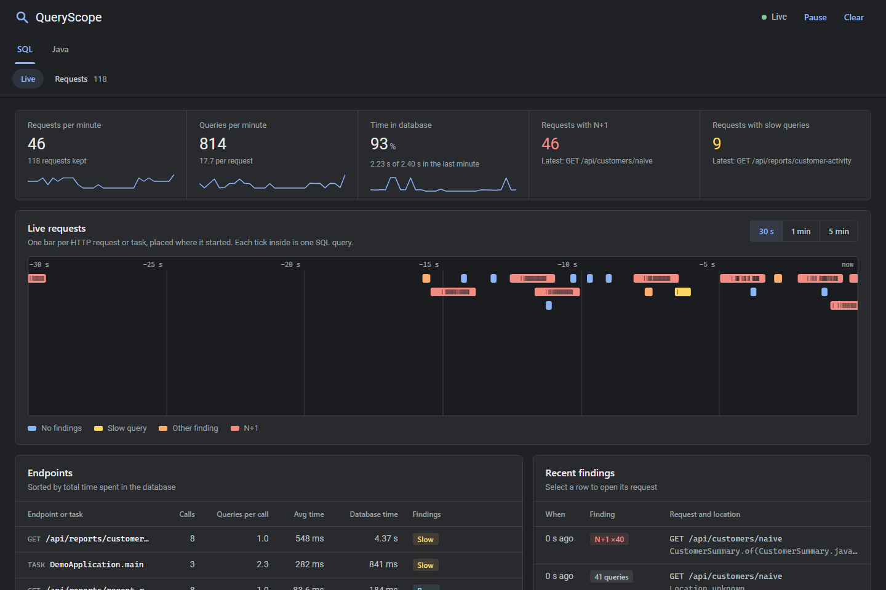
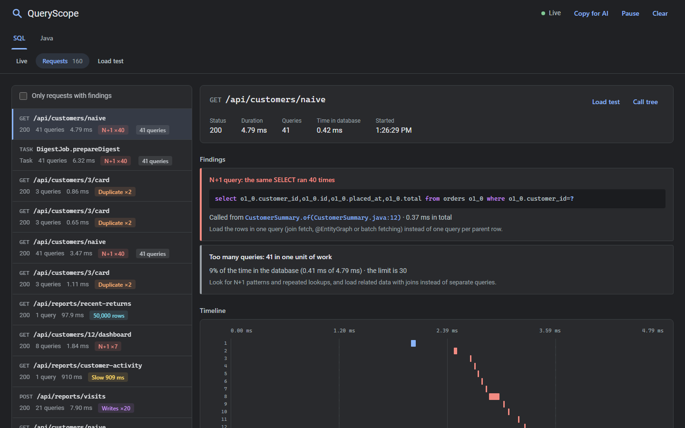
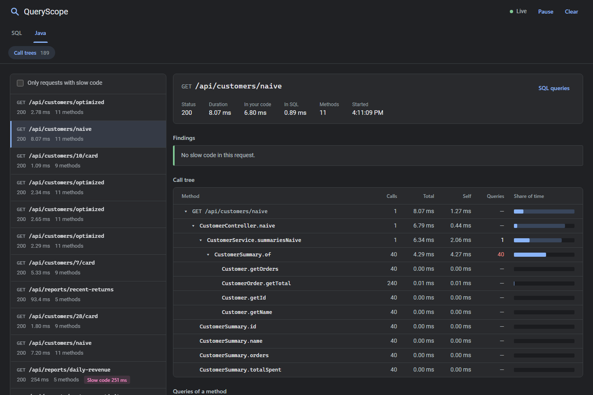
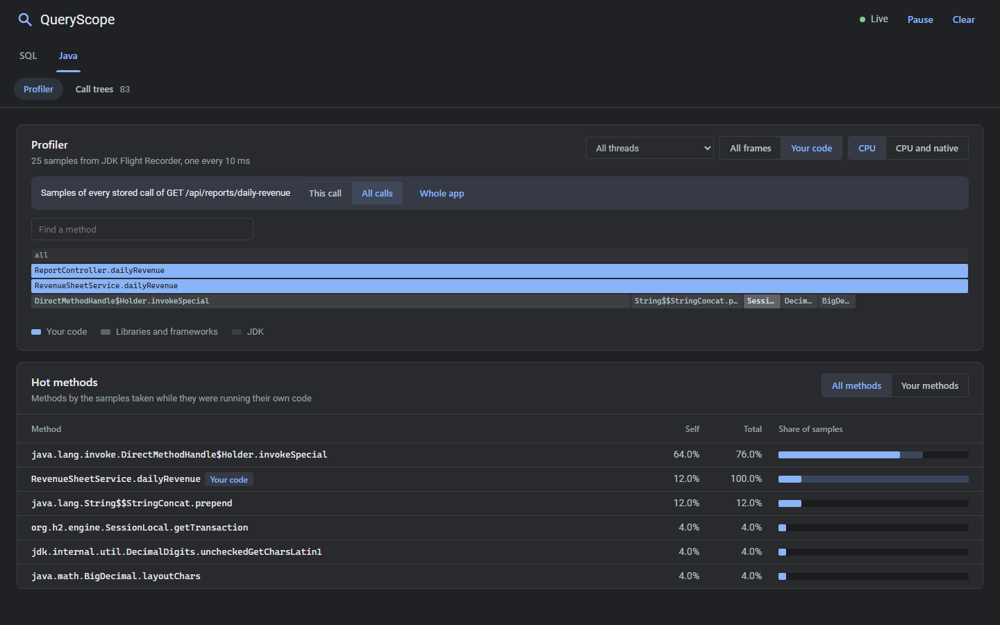

<h1 align="center">QueryScope</h1>

<p align="center">
  <b>Find N+1 queries, slow SQL and slow Java code in any Java app, without touching its code.</b><br>
  A Java agent that records every JDBC query and every call of your own methods per request, samples the CPU with JDK
  Flight Recorder, and shows it all live in the browser.
</p>

<p align="center">
  <a href="https://github.com/zitreF/queryscope/actions/workflows/build.yml"></a>
  
  
  
  
</p>



## Start

```bash
java -jar queryscope.jar                          # pick a running Java app in the browser and attach to it
java -jar queryscope.jar your-app.jar             # or start your app with QueryScope from its first line
java -javaagent:queryscope.jar -jar your-app.jar  # or add the agent to any java command
```

Then use the app. The panel at http://localhost:7070 fills up as requests come in, and when the app stops, QueryScope
prints a summary of the session. The [usage guide](docs/usage.md) has the details for Gradle, Maven, IntelliJ and Docker.

## What it shows

- **N+1 queries**, with the line of your code that triggers them, for example `CustomerSummary.of(CustomerSummary.java:12)`.
- **More SQL checks**: slow queries, unbatched writes, duplicate queries with the same parameters, large results and
  requests that run too many queries. Every query comes with its parameters and the rows it returned.
- **Slow code**: methods that spend their time in Java rather than in the database, with warm-up left out.
- **A call tree of your methods** for every request and task, with the queries each method ran, so an N+1 points at
  the method that loops.
- **A sampling profiler** on JDK Flight Recorder that sees every method of any Java program, your code, libraries and
  the JDK, as a flame graph for the whole app, one thread, one request or one endpoint.
- **Method tracing on demand**: pick any method of your code or a library while the app runs and see every call, its
  percentiles and the requests behind its slowest calls.
- **Load tests**: send a GET request the app already served hundreds or thousands of times and see requests per
  second and latency percentiles next to the queries per request and findings QueryScope saw inside the app.
- **Help for your AI assistant**: **Copy for AI** puts a Markdown report of everything above on the clipboard, and
  the panel is an MCP server, so Claude Code and other assistants can read findings and requests, trace methods and
  run load tests themselves.
- **Live tracking** of requests on a moving time axis, and a **session summary** of endpoints, findings and the
  hottest methods when the app stops.

It works with any JDBC driver and pool, Hibernate, Spring Data, jOOQ or plain JDBC, recognizes HTTP requests in any
servlet container on `jakarta.servlet` and `javax.servlet` and in the JDK's built-in `HttpServer`, and groups
everything else, scheduled jobs, listeners, batch runs and plain `main` programs, into tasks. Nothing goes into your `pom.xml` or `build.gradle`.

## Try it on the demo

The tests contain a small shop with deliberate problems. `runDemo` builds the agent and starts the shop with it:

```bash
git clone https://github.com/zitreF/queryscope.git
cd queryscope
./gradlew runDemo
```

On Windows use `gradlew.bat`. Open the panel at http://localhost:7070 and call the endpoints:

| Endpoint                                            | What it does                                                        | QueryScope shows        |
|-----------------------------------------------------|---------------------------------------------------------------------|-------------------------|
| http://localhost:8080/api/customers/naive           | `findAll()`, then reads each customer's lazy `orders` collection    | 41 queries, N+1 ×40     |
| http://localhost:8080/api/customers/optimized       | the same summaries with `left join fetch c.orders`                  | 1 query, no findings    |
| http://localhost:8080/api/reports/customer-activity | joins 150k audit events with customers on an unindexed email column | slow query, about 0.5 s |
| http://localhost:8080/api/customers/7/card          | looks the customer's name up twice through the same helper          | duplicate query `[7]`   |
| http://localhost:8080/api/reports/recent-returns    | loads every return event and keeps the 20 newest in memory          | 50,000 rows             |
| `curl -X POST localhost:8080/api/reports/visits`    | inserts 20 events one statement at a time                           | 20 unbatched writes     |
| http://localhost:8080/api/reports/daily-revenue     | builds a year of daily revenue as CSV with `+=` in a loop           | slow method             |

A scheduled job builds the same naive summaries every 30 seconds outside any HTTP request and shows up as the task
`DigestJob.prepareDigest`, and the data loaded at startup shows up as `DemoApplication.main`.

Then press **Load test** on `/api/customers/naive` and on `/api/customers/optimized`: the optimized endpoint answers
several times more requests per second, with 1 query per request instead of 41.

## Example: finding and fixing an N+1

The service builds a summary of every customer, with the number of orders and the money spent:

```java
public List<CustomerSummary> summariesNaive() {
    return customers.findAll(Sort.by("id")).stream()
            .map(CustomerSummary::of)
            .toList();
}
```

`findAll` loads the 40 customers in one query, but `CustomerSummary.of` reads `customer.getOrders()`, a lazy
collection, so Hibernate goes back to the database once for every customer.

**1. Call the endpoint** with the demo running: `curl http://localhost:8080/api/customers/naive`.

**2. See what QueryScope found.** The SQL tab shows the request with an `N+1 ×40` badge, the 40 repeated queries red
on its timeline, and the line that runs them:



**Call tree** opens the same request in the Java tab, where the 40 queries sit on `CustomerSummary.of`, called once
per customer from `CustomerService.summariesNaive`:



The application's own log says the same:

```
INFO  QueryScope : GET /api/customers/naive -> 200, 41 queries in 46.9 ms
WARN  QueryScope : N+1: 40 x select o1_0.customer_id,o1_0.id,o1_0.placed_at,o1_0.total from orders o1_0 where o1_0.customer_id=? at me.fertiz.queryscope.demo.customer.CustomerSummary.of(CustomerSummary.java:12)
```

**3. Fix it** by loading the orders together with the customers:

```java
@Query("select c from Customer c left join fetch c.orders order by c.id")
List<Customer> findAllWithOrders();
```

**4. Check again.** The fixed endpoint returns exactly the same summaries with one query and no warning:

```
INFO  QueryScope : GET /api/customers/optimized -> 200, 1 query in 21.8 ms
```

The Profiler in the Java tab shows the app from the CPU's side. The demo's CSV export builds its text with `+=` in a
loop, and the flame graph of its calls points at `RevenueSheetService.dailyRevenue` and the JDK's string
concatenation right under it:



## Documentation

- **[Usage guide](docs/usage.md)**: the three ways to start QueryScope, a tour of the panel, every finding and what to
  do about it, all options, the session summary, the JSON API for scripts and tests, troubleshooting and limitations.
- **[How it works](docs/how-it-works.md)**: the technical side, from `premain`, `agentmain` and the Attach API through
  the bytecode instrumentation, units of work, query tracing, the call tree, the analyzer and the Flight Recorder
  profiler to the panel, its security, memory limits, overhead and tests.

QueryScope is a development tool. It keeps SQL with bound parameters in memory and its panel has no login, so do not
attach it in production.

## Built with

- **Java 25** to build, while the agent itself targets **Java 17**
- **Java Instrumentation API** (`-javaagent`, `agentmain`) and **ByteBuddy 1.18** for bytecode instrumentation
- **JDK Attach API** to load the agent into running applications
- **JDK Flight Recorder** (`RecordingStream`, `jdk.ExecutionSample`) for the sampling profiler, with thread dumps as a
  fallback, and **StackWalker** for call sites
- **JDBC** and **Servlet** APIs, with `jakarta` and `javax` both read through `MethodHandle`s
- **JDK HttpServer** with server-sent events for the panel, written in plain HTML, CSS and JavaScript
- **Gradle 9** with Kotlin DSL and a version catalog, and **Shadow** to shade ByteBuddy into a single jar
- **JUnit 5**, **Spring Boot 4.1**, **Hibernate**, **HikariCP** and **H2** for the tests and the demo shop
- **GitHub Actions** on Temurin 25 for CI, **IntelliJ IDEA**, **Git** and **GitHub**
- **Claude Code** was used as an AI assistant for research, testing, documentation and commit messages

## Building and testing

```bash
./gradlew build
```

The Gradle wrapper is included, the build needs JDK 25 installed. `build` writes the agent to `build/libs/queryscope.jar`
and runs every test, from unit tests to end-to-end tests that start the demo in separate JVMs with the agent attached,
through the launcher and through the hub. [How it works](docs/how-it-works.md#testing) lists them.

One more end-to-end test deploys a WAR to a standalone Tomcat. It needs a Tomcat 10.1 or newer on disk and runs only
when you point the build at it:

```bash
./gradlew test -Ptomcat=/path/to/apache-tomcat-11.0.27
```
