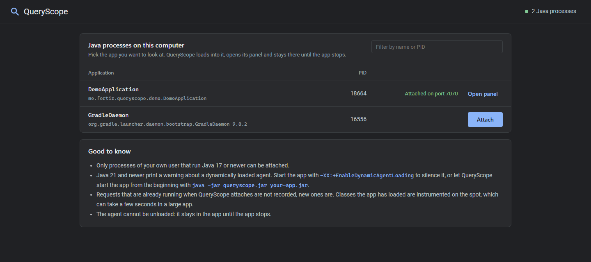
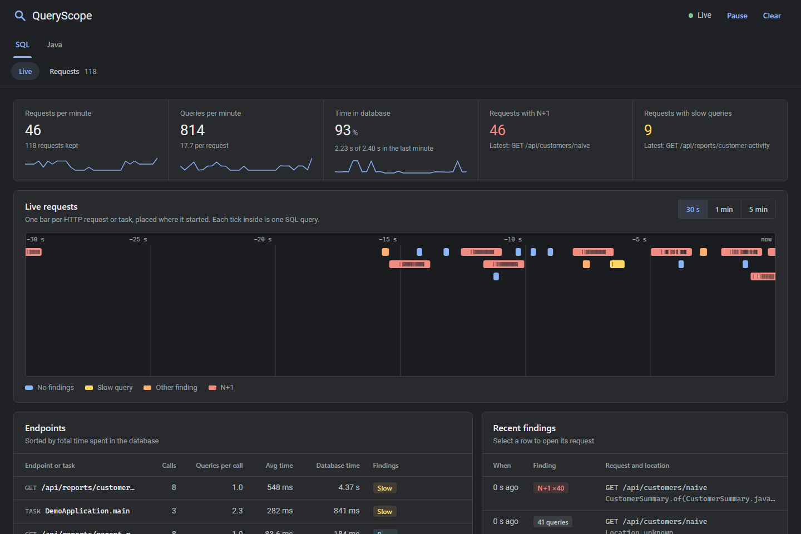
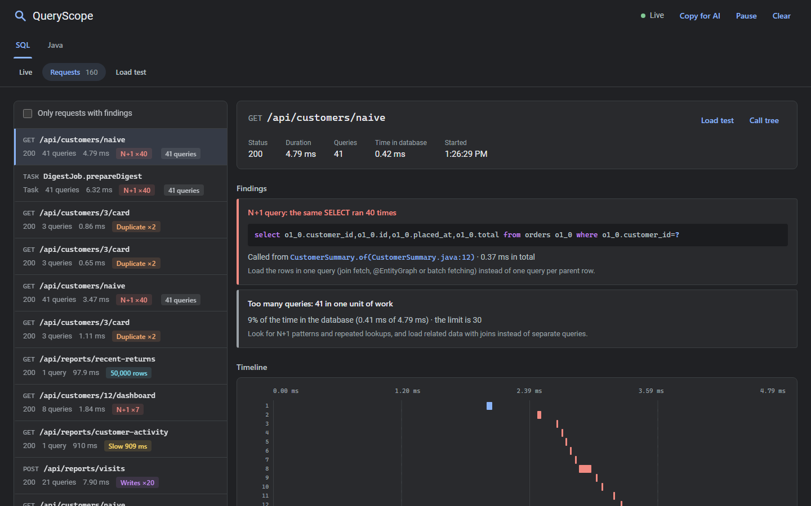
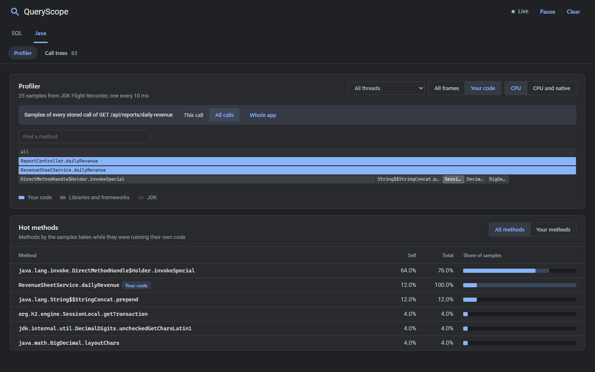
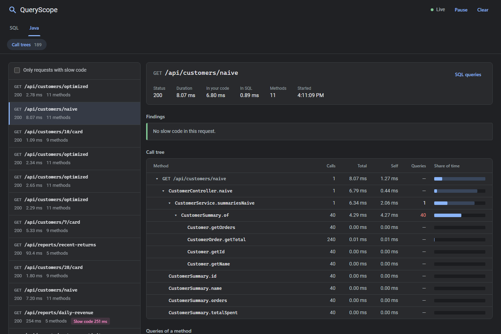

# Using QueryScope

This guide covers getting the agent, the three ways to start it, what the panel shows, every finding and option,
the JSON API and what to do when something does not work. For the internals, see [How QueryScope works](how-it-works.md).

- [Requirements](#requirements)
- [Getting the agent](#getting-the-agent)
- [Starting QueryScope](#starting-queryscope)
- [A tour of the panel](#a-tour-of-the-panel)
- [Findings](#findings)
- [Options](#options)
- [Session summary](#session-summary)
- [Scripts and tests](#scripts-and-tests)
- [Troubleshooting](#troubleshooting)
- [Limitations](#limitations)

## Requirements

- The application runs on **Java 17 or newer**, on any JVM. Flight Recorder sampling needs HotSpot (Temurin, Oracle,
  Corretto, Zulu and the like). Other JVMs fall back to thread dumps.
- Attaching to a running application needs QueryScope itself to run on a **JDK**, because the Attach API lives in the
  `jdk.attach` module that a JRE does not have.
- The database is reached through **JDBC**, directly or through Hibernate, Spring Data, jOOQ, MyBatis, `JdbcTemplate`,
  `JdbcClient` or anything else built on it.

## Getting the agent

```bash
git clone https://github.com/zitreF/queryscope.git
cd queryscope
./gradlew shadowJar
```

This writes `build/libs/queryscope.jar`, a single jar with ByteBuddy shaded inside. Copy it anywhere, for example next
to the jar of your application. Building needs JDK 25; the jar runs on Java 17 and newer.

## Starting QueryScope

There are three ways to get QueryScope into an application. All of them end in the same panel.

| Way                         | Command                                          | When to use it                                         |
|-----------------------------|--------------------------------------------------|--------------------------------------------------------|
| Attach to a running app     | `java -jar queryscope.jar`                       | The app is already running, or started by an IDE       |
| Start the app with it       | `java -jar queryscope.jar your-app.jar`          | You run the app's jar or main class from a terminal    |
| `-javaagent` on the app JVM | `java -javaagent:queryscope.jar -jar your-app.jar` | Build tools, IDE run configurations, scripts, tests  |

### Attach to a running app

```bash
java -jar queryscope.jar
```

QueryScope starts its hub at http://localhost:7070 and opens it in the browser. The hub lists every Java process of
your user on this computer. **Attach** loads QueryScope into the process you pick, and **Open panel** opens the panel
of that process on a port of its own. Attach as many processes as you like; attaching the same process again just
returns its panel.



The same works without a browser, for scripts:

```bash
java -jar queryscope.jar --attach=12345
```

```
QueryScope is attached to process 12345, its panel is at http://localhost:61234
```

Good to know before attaching:

- Requests that are running at the moment of attaching are not recorded; every request after it is.
- Classes the app has already loaded are instrumented on the spot. In a large app this takes a few seconds, and the
  first requests afterwards are slower while the JVM warms up again.
- Java 21 and newer print `WARNING: A Java agent has been loaded dynamically` in the app's log. Start the app with
  `-XX:+EnableDynamicAgentLoading` to silence it. A future Java release will refuse dynamic agents unless that flag is
  set, so starting the app with QueryScope is the safer habit for the long run.
- An agent cannot be unloaded. QueryScope stays in the app until the app stops.
- The hub takes `--port=7070` for its own port and `--open=false` to keep it from opening the browser. Every other
  option, such as `--slowQueryMs=250`, is passed on to the agents it attaches.

### Start the app with QueryScope

```bash
java -jar queryscope.jar your-app.jar
java -jar queryscope.jar --open --port=9090 --slowQueryMs=250 your-app.jar --server.port=8081
java -Xmx1g -Dspring.profiles.active=local -jar queryscope.jar -cp "lib/*" com.acme.Main
```

QueryScope starts your application in a new JVM with the agent attached from the first line of `main`:

- Options before the jar, or before `-cp` and the main class, go to QueryScope, written as `--name=value`.
- Arguments after the jar go to the application.
- JVM options of the `java` command itself, such as `-Xmx1g` or `-Dspring.profiles.active=local`, are passed on to the
  application. Other agents and debugger options are not, so QueryScope does not end up attached twice.
- Ctrl+C stops both. If the launcher is killed, the application shuts itself down instead of holding on to its port.
- The launcher also asks Flight Recorder for stacks of up to 256 frames instead of 64, so deep framework stacks are not
  cut in the flame graph.

`java -jar queryscope.jar --help` prints every option.

### `-javaagent` on the app JVM

Pass the jar to the JVM that runs your application. Options go after the jar path, separated by commas:

```bash
java -javaagent:/path/to/queryscope.jar -jar your-app.jar
java -javaagent:/path/to/queryscope.jar=port=9090,slowQueryMs=250,entry=com.acme.ImportJob#run -jar your-app.jar
```

Add `-XX:FlightRecorderOptions=stackdepth=256` to get the same deep stacks as with the launcher.

**Gradle `bootRun`** (`build.gradle.kts`)

```kotlin
tasks.bootRun {
    jvmArgs("-javaagent:/path/to/queryscope.jar")
}
```

**Maven**

```bash
./mvnw spring-boot:run -Dspring-boot.run.jvmArguments="-javaagent:/path/to/queryscope.jar"
```

**IntelliJ IDEA**: *Run → Edit Configurations → Modify options → Add VM options*, then enter
`-javaagent:/path/to/queryscope.jar`. Or start the app as usual and attach from the hub.

**Docker**: add the jar to the image and the option to `JAVA_TOOL_OPTIONS`. The panel listens on loopback only, so
reach it from inside the container's network namespace, for example with `docker exec` and `curl`, or attach from a
QueryScope hub that runs in the same container.

### Starting the demo

The repository ships a small shop with deliberate problems, see the README. `./gradlew runDemo` builds the agent and
starts the shop with it on http://localhost:8080, with the panel on http://localhost:7070.

## A tour of the panel

The panel has two areas: **SQL** for queries and **Java** for code. Each has its own views, and a request found in one
area opens in the other with one click.

### SQL → Live



- **Counters** for the last minute: requests and queries per minute, the share of time spent in the database, and the
  requests with N+1 or slow queries, each with a small sparkline.
- **Live requests** draws every request or task as a bar where it started, with one tick per query inside. Red bars
  are N+1, yellow ones slow, orange ones any other SQL finding. Hover for details, click to open the request. The time
  window is 30 seconds, 1 or 5 minutes.
- **Endpoints** groups the requests by method and path, with IDs folded into `{id}`, sorted by time in the database.
- **Recent findings** lists the latest findings with the line of code behind each one.
- **Pause** freezes the view while requests keep being recorded; **Resume** shows what arrived in between. **Clear**
  empties the panel.

### SQL → Requests



The list on the left holds the last 200 requests and tasks that ran SQL, newest first. *Only requests with findings*
hides the clean ones. The details of a request show:

- its status, duration, number of queries and time in the database;
- a card for every finding, with the SQL, the line of code and what to do about it;
- a timeline with one bar per query, coloured by the finding it belongs to;
- every query with its start, duration, rows, SQL with syntax highlighting, bound parameters and call site.

**Call tree** in the header opens the same request in the Java area.

### Java → Profiler



The profiler shows where the CPU time of the application goes, from samples taken by Flight Recorder every 10 ms.

- **Time window**: the last 1, 5 or 15 minutes. The view refreshes every 5 seconds.
- **Thread**: all threads, or one of them, with its number of samples.
- **Frames**: *Your code* shows only the methods of your packages plus the method the sample was actually in, which
  is usually the most readable view. *All frames* shows every frame, from `Thread.run` down through the framework.
- **Samples**: *CPU* counts threads running Java code. *CPU and native* adds threads inside native code, such as
  reading from a socket.
- **Flame graph**: every bar is a method, as wide as its share of the samples, with the methods it called below it.
  Your code is blue, libraries are gray, the JDK is dark gray. Click a bar to zoom into it, click an upper bar or
  **Reset zoom** to go back. **Find a method** highlights the bars that match.
- **Hot methods**: *All methods* ranks methods by the samples taken in their own code (self). *Your methods* ranks your
  methods by the samples taken in them or in library code they call, which is usually where a fix starts. A click
  highlights the method in the flame graph.

When the profiler is opened for one request, a bar on top says so: **This call** shows the samples of that call,
**All calls** the samples of every stored call of the same endpoint, and **Whole app** goes back to everything. A
short request has few samples, so *All calls* is often the better view.

### Java → Call trees



The call tree records every call of your own methods, exactly, with the queries each one ran. The list holds the last
requests and tasks that ran your code, also those without any SQL. The details show:

- the time spent in your code and in SQL;
- slow code findings;
- the call tree: calls, total time, self time, queries and share of the request for every method, with branches that
  matter expanded. Methods that were already running when a task started are marked *already running*;
- *Queries of a method*: click a method with queries to see its SQL;
- *Methods by self time*: the methods that kept the request busy, summed over all their calls.

**CPU samples** opens the profiler for the request, **SQL queries** opens it in the SQL area.

## Findings

| Finding           | Area | Reported when                                                                 | Option              |
|-------------------|------|-------------------------------------------------------------------------------|---------------------|
| N+1               | SQL  | the same SELECT, whatever its values, runs at least 5 times in one request    | `nPlusOneThreshold` |
| Unbatched writes  | SQL  | the same INSERT, UPDATE or DELETE runs at least 5 times in one request        | `nPlusOneThreshold` |
| Duplicate query   | SQL  | the same SELECT with the same parameters runs twice, outside an N+1           |                     |
| Slow query        | SQL  | a query takes 100 ms or more                                                  | `slowQueryMs`       |
| Large result      | SQL  | a query returns 500 rows or more                                              | `largeResultRows`   |
| Too many queries  | SQL  | a request or task runs 30 queries or more                                     | `maxQueries`        |
| Slow code         | Java | a method spends 100 ms or more in its own code, outside SQL, in one request   | `slowMethodMs`      |

Queries are compared after their literals are replaced with `?`, so `where id = 1` and `where id = 2` count as the
same query. Slow code is not reported while the JVM is warming up, which QueryScope recognizes by 50 or more classes
loaded during the request; the call tree says so when it happens.

What to do about each:

- **N+1**: load the related rows in one query, with a join fetch, `@EntityGraph`, `@BatchSize` or batch fetching.
- **Unbatched writes**: send them as one batch, with `addBatch` and `executeBatch`, or `hibernate.jdbc.batch_size`
  and sequence-generated IDs.
- **Duplicate query**: reuse the first result, pass it along, or cache it for the request.
- **Slow query**: look at the query plan with `EXPLAIN`: a full table scan, a missing index or a join on an unindexed
  column.
- **Large result**: fetch only what the response needs: paginate, filter in SQL, select fewer columns.
- **Too many queries**: look for N+1 patterns and repeated lookups and load related data with joins.
- **Slow code**: the time goes to Java, not the database. Look for loops that build strings, heavy mapping or
  serialization and blocking calls; the profiler shows which method underneath takes it.

## Options

With the launcher and the hub, options are `--name=value` arguments before the application. With `-javaagent` they go
after the jar path, separated by commas: `-javaagent:queryscope.jar=port=9090,slowQueryMs=250`.

| Option              | Default    | Meaning                                                                 |
|---------------------|------------|-------------------------------------------------------------------------|
| `port`              | `7070`     | Port of the panel, or of the hub, on localhost                          |
| `open`              | `false`    | Opens the panel in the browser once it is running; the hub opens it unless `open=false` |
| `summary`           | `true`     | Prints the session summary when the JVM stops                           |
| `nPlusOneThreshold` | `5`        | Runs of the same SELECT, or write, in one request that are reported     |
| `slowQueryMs`       | `100`      | Queries taking at least this long are slow                              |
| `largeResultRows`   | `500`      | Queries returning at least this many rows are reported                  |
| `maxQueries`        | `30`       | Requests or tasks running at least this many queries are reported       |
| `slowMethodMs`      | `100`      | Methods spending at least this long in their own code are reported      |
| `package`           | main class | Package whose methods form the call tree and count as your code, can be repeated |
| `profile`           | `true`     | Records the call tree of your methods                                   |
| `sampling`          | `true`     | Runs the sampling profiler                                              |
| `sampleMs`          | `10`       | How often the profiler takes a sample, from 1 to 1000 ms                |
| `entry`             | none       | `Class#method` whose whole call becomes one task, can be repeated       |
| `attach`            | none       | Hub only: attaches to this process ID and exits                         |

`open`, `summary`, `profile` and `sampling` work without a value, so `--open` means `--open=true`. An unknown option or
an invalid value stops QueryScope at startup with a message that names it. Anything else that fails at startup, such as
a runtime built without the `jdk.httpserver` or `java.sql` module, is logged and the application runs on without
QueryScope or without its panel. When 7070 is taken, for example by the hub, the panel and the hub move to a free port
and the log shows which one. A port given with `port` is never swapped: if it is taken, the panel is skipped and
findings still go to the log.

**Your packages.** QueryScope takes them from the main class of the application, or from `Start-Class` and
`Main-Class` in the manifest of its jar, so `com.acme.shop.ShopApplication` means `com.acme.shop`. If the main class
sits in a sub-package, or your code spans several packages, list them: `--package=com.acme.shop --package=com.acme.billing`.

**Requests and tasks.** HTTP requests are recognized in any servlet container, on `jakarta.servlet` and
`javax.servlet`, so Spring Boot 2, 3 and 4, Tomcat, Jetty and Undertow all work. Queries outside a request, in
scheduled jobs, message listeners, batch runs or a plain `main`, become tasks: a task starts with the first query,
ends when the connection is closed or the transaction committed, and is named after the outermost method of yours
that was running, such as `DigestJob.prepareDigest`. `entry=com.acme.ImportJob#run` turns every call of that method
into one task, however many connections it uses.

## Session summary

When the application stops, QueryScope prints what it saw. `summary=false` turns it off.

This is the summary of two minutes in the demo shop, a little shortened:

```
QueryScope session summary: 2 min 15 s, 83 requests and tasks, 1215 queries, 736 CPU samples

  Endpoint or task                                  Calls  Queries/call   Avg time    DB time  Findings
  GET /api/reports/customer-activity                   13           1.0   529.2 ms     6.82 s  Slow
  GET /api/reports/recent-returns                       3           1.0   162.7 ms    80.5 ms  Rows, Code
  GET /api/customers/naive                             24          41.0    20.7 ms    49.6 ms  N+1, Queries
  GET /api/customers/optimized                         21           1.0    23.0 ms     9.8 ms  -
  Task DigestJob.prepareDigest                          4          41.0     9.4 ms     5.1 ms  N+1, Queries
  GET /api/customers/{id}/card                          7           3.0     3.0 ms     2.4 ms  Duplicate
  GET /api/reports/daily-revenue                        2           1.0   413.0 ms     0.4 ms  Code

  Findings, most frequent first
     28 x  N+1: 40 x select o1_0.customer_id,o1_0.id,o1_0.placed_at,o1_0.total from orders o1_0 where o1_0.customer_id=? at me.fertiz.queryscope.demo.customer.CustomerSummary.of(CustomerSummary.java:12)  (GET /api/customers/naive)
     13 x  Slow query: 534.9 ms select c.name as customer, count(*) as events from audit_events e join customers c on c.email = e.actor_email group by c.name order by events desc limit ? at me.fertiz.queryscope.demo.report.AuditReportService.mostActiveCustomers(AuditReportService.java:29)  (GET /api/reports/customer-activity)
      2 x  Slow method: RevenueSheetService.dailyRevenue spent 538.1 ms in its own code outside SQL over 1 call, 98% of the time  (GET /api/reports/daily-revenue)

  Hottest methods by CPU samples
    Self  Total  Method
    7.7%   8.0%  java.util.HashMap.getNode
    7.6%  11.3%  org.h2.value.Value.compareToNotNullable
    7.1%   9.2%  org.h2.mvstore.Cursor.hasNext

  Your methods by CPU time in them and in the library code they call
   60.5%  me.fertiz.queryscope.demo.report.AuditReportService.mostActiveCustomers
   21.9%  me.fertiz.queryscope.demo.DemoApplication.main
    4.2%  me.fertiz.queryscope.demo.report.AuditReportService.recentReturns

  QueryScope itself took 184 more samples, mostly instrumenting classes at startup
```

The hottest methods here are H2's, because the demo's database runs inside the same JVM; with a separate database
server they would be your code, your libraries and the JDBC driver.

IDs in paths are folded, so `/api/customers/7` and `/api/customers/8` count as `GET /api/customers/{id}`. A program that
never runs SQL still gets the hottest methods, which makes the summary a quick profiler for command line tools.

## Scripts and tests

The panel is backed by a small JSON API on the same port:

| Endpoint                       | Returns                                                                               |
|--------------------------------|---------------------------------------------------------------------------------------|
| `GET /api/requests`            | the last 200 requests with SQL and the last 200 without, newest first, with queries and findings |
| `DELETE /api/requests`         | clears them                                                                           |
| `GET /api/events`              | a server-sent events stream with one `request` event per finished request             |
| `GET /api/requests/{id}/calls` | the call tree of one stored request, with the queries of each method                  |
| `GET /api/profile`             | a flame graph and the hot methods                                                     |

A request or entry task keeps its first 1000 queries in `queries`; any beyond that are counted in `omittedQueries` and
their time in `omittedMs`, and they still count for *Too many queries* and the time in the database.

`/api/profile` takes `window` (seconds, default 300), `thread` (an ID or `all`), `frames` (`all` or `app`), `samples`
(`cpu` or `all`), and `request` with `scope` (`request` or `endpoint`) to look at one request or its endpoint.

The hub has `GET /api/processes` and `POST /api/attach` with a body like `{"pid": 12345}`.

List the requests with a finding after clicking through the demo:

```bash
curl -s localhost:7070/api/requests | jq -c '.[] | select(.findings != []) | {path, findings: [.findings[].type]}'
```

```
{"path":"/api/reports/customer-activity","findings":["slowQuery"]}
{"path":"/api/customers/naive","findings":["nPlusOne","tooManyQueries"]}
```

Each finding carries what it needs, for example the normalized SQL, the call site and the indexes of its queries:

```json
{
  "type": "nPlusOne",
  "sql": "select o1_0.customer_id,o1_0.id,o1_0.placed_at,o1_0.total from orders o1_0 where o1_0.customer_id=?",
  "callSite": "me.fertiz.queryscope.demo.customer.CustomerSummary.of(CustomerSummary.java:12)",
  "executions": 40,
  "totalMs": 10.039,
  "queryIndexes": [1, 2, 3, 4]
}
```

This makes QueryScope a guard against regressions: start the app with the agent in an end-to-end test, call an
endpoint, and fail when its request has a finding. The
[end-to-end test](../src/test/java/me/fertiz/queryscope/e2e/QueryScopeEndToEndTest.java) of this repository does exactly
that for the demo.

## Troubleshooting

**The panel does not open.** Look for `QueryScope panel is running at` in the application's log; it names the port,
which is not 7070 when 7070 was taken. If a port given with `--port` was taken, the log says so; pick another one.

**"QueryScope could not tell the application's package".** The main class is a launcher, a framework class or sits in
a single-segment package. Pass `--package=com.acme` and the call tree, slow code and *Your code* views come back.

**My method is missing from the call tree.** Only methods of your packages are recorded, and lambdas, constructors and
default methods of interfaces are folded into the method that calls them. Generated proxies such as `$$SpringCGLIB$$`
are skipped on purpose.

**A request has almost no samples.** Flight Recorder samples every 10 ms and only a few threads per tick, so a 20 ms
request gets one or two samples. Choose **All calls** to see every call of the endpoint, or lower `sampleMs`.

**The flame graph has a `(truncated stack)` bar.** The stack was deeper than Flight Recorder keeps. Start the app with
the launcher, or add `-XX:FlightRecorderOptions=stackdepth=256`.

**The hub does not list my app.** It lists Java processes of your own user. Processes started with
`-XX:+DisableAttachMechanism`, inside containers, or by another user are not visible. Java versions before 17 show up
but cannot load the agent, and the hub says so.

**"Attaching needs a JDK".** Run `queryscope.jar` with a JDK rather than a JRE; the application itself may still run on
a JRE.

**The first requests after attaching are slow.** The JVM recompiles the methods QueryScope instrumented. It settles after
a few requests, and slow code is not reported while classes are still being loaded.

**Production.** QueryScope keeps SQL with bound parameters (strings cut at 64 characters, binary values shown as their
size) and call trees in memory, and its panel has no login. It is a development tool, so do not attach it in
production.

## Limitations

- Queries a request runs on another thread (`DeferredResult`, `@Async`, `CompletableFuture`) show up as separate tasks
  rather than as part of the request.
- Reactive stacks are not covered: WebFlux and Vert.x requests are not recognized, and R2DBC is not JDBC.
- HTTP servers that are not servlet containers, such as the JDK's `HttpServer` or Netty, are not recognized as
  requests. Their queries still show up as tasks.
- `Statement.addBatch(sql)` batches are not recorded. Prepared statement batches are.
- Call sites skip `org.springframework.*` frames, so apps whose own code lives under that package, such as Spring
  PetClinic, show the nearest frame outside it.
- The call tree costs a few dozen nanoseconds per call of your methods. A tight loop that calls tiny methods millions
  of times gets noticeably slower; `profile=false` turns the call tree off.
- Flight Recorder samples only threads running Java code, skips threads inside some JVM stubs such as array copies,
  and does not sample threads that sleep or wait on a lock.
- An attached agent cannot be unloaded, and requests already running when it attaches are not recorded.
